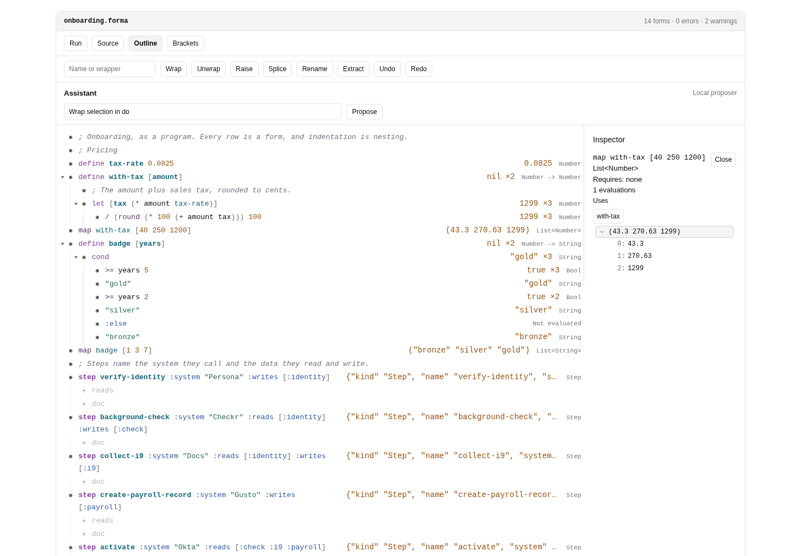
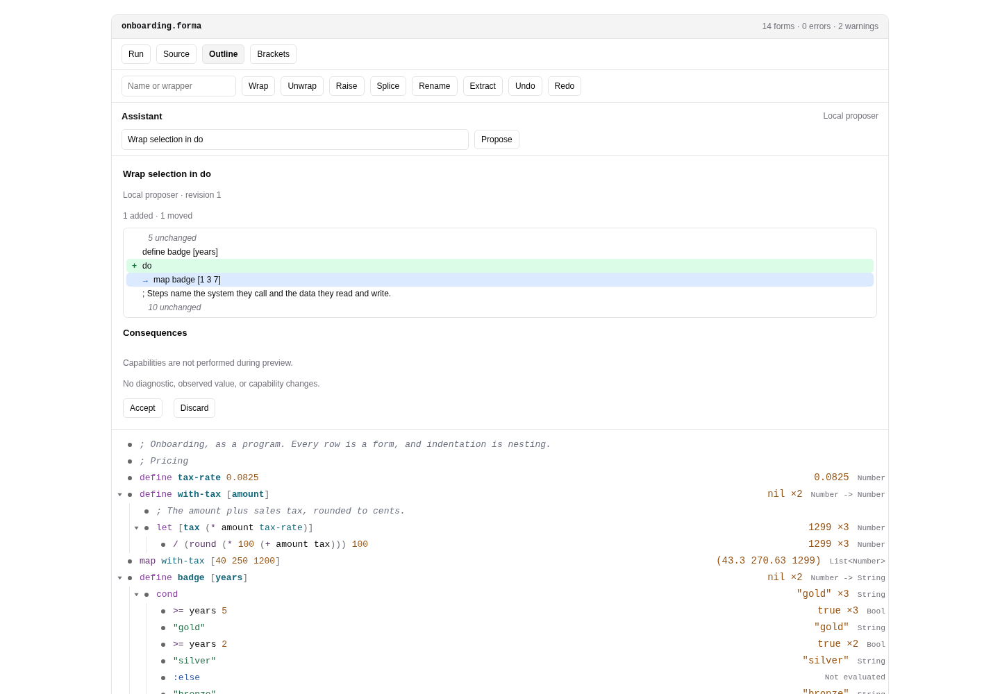

# The Forma workbench in Foldworks

<a href="/workbench/demo/" target="_self">Open the workbench in Foldworks</a>.
The structural workbench is an app owned and deployed by Foldworks. It composes
Forma's language service with Foldworks' outline, editor, inspector, history,
and agent surfaces. Forma has no Foldworks dependencies.

The old `/workbench/demo/` URL redirects to that app. The destination lives in
one constant, `apps/website/src/lib/workbenchLocation.ts`, so it can be updated
without rebuilding or importing the workbench into Forma. Both legacy paths,
with and without the trailing slash, preserve query parameters.

Forma remains pre-alpha. APIs, syntax, package boundaries, and artifact formats
can change. The [workbench vision](./workbench-vision.md) distinguishes the
longer-term goals from the implemented language services.

## What Forma owns

`@forma-language/forma` owns parsing, inference, evaluation, elaboration, stable syntax
identity, outline/source conversion, observations, and structural edit scripts.
`@forma-language/forma/host` provides the asynchronous `LanguageHost` ABI, sessions,
source/prelude loading, editor analysis, symbol indexing, navigation, completion,
refactoring, descriptor slots, retained values, and suspended host calls.
See [Language services](./language-services.md).

Reusable helpers formerly implemented inside the workbench live in the engine's
internal authoring module (not a public subpath of `@forma-language/forma`):

- `requirementsFor` propagates capability names through resolved definitions,
  children, and recursive references. It is a conservative graph calculation,
  not a replacement for approval at the actual host-call boundary.
- `mergeReplSource` merges scratch declarations by kind and name;
  `replDefinitions` selects declarations and can omit those with capability
  requirements. Applications still own evaluation and session lifecycle.
- `rowLayouts`, `nodeAt`, `rowContaining`, and `rangeInRow` map between outline
  rows and source spans without a UI toolkit.
- `descriptorForms` finds top-level descriptor forms using the caller's
  descriptor predicate; `blank` masks spans while preserving source offsets
  and line breaks.

These helpers import no Foldworks, Foldkit, DOM, or React code. The host's
existing APIs and their conformance tests stay in Forma.

## What Foldworks owns

The app owns layout, focus, keyboard interaction, outline/source presentation,
undo histories, inspection views, assistant proposal review, and capability
approval controls. The migration starts from Forma commit `61a546a`, where
`packages/workbench` and `apps/workbench` held that composition. Those directories
and the unpublished-package link/install workaround are no longer part of
Forma's workspace.

The outline remains a view of the same source document. Row edits, source edits,
refactorings, and accepted proposals use the language service's node identities
and edit contracts. Permission prompts belong to the app; execution pauses at
Forma's host-call boundary until a host supplies a result or denial.

The screenshots show the app before its repository move. Consult Foldworks for
app setup, packaging, deployment, and browser interaction tests. Forma's own
frozen install needs no Foldworks checkout, link hook, or tarballs.

## The source-first live compiler stays here

The homepage and language pages still embed Forma's `LiveWorkbench` and
`WorkbenchEditor`. These use the Web Worker compiler and `@forma-language/forma/editor`,
with CodeMirror and React. They are separate from the structural Foldworks app.
See [Live workbench embeds](./workbench-embeds.md).

## Current language-service limits

Evaluation stops at the first failure; observation is not a step trace. Host
calls have no exact dynamic source span. The kernel does not execute operational
Effect programs. File persistence and application-level approval policy belong
to hosts. Moving the app does not implement the follow-ups in the vision or
change these language contracts.
