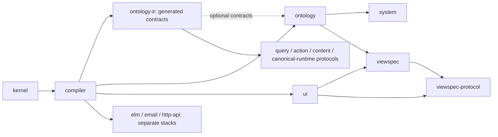

# Forma preludes

These Lisp sources demonstrate how Forma grows from a small typed core into
domain-specific languages. `kernel.lisp` supplies general-purpose macros,
`compiler.lisp` supplies shared projection helpers and macros, and the remaining files are
an example domain stack with elaboration and portable artifact protocols.

The conformance fixtures and example corpus load these files as their domain
stack. Applications are not required to use this domain vocabulary: hosts and the language server accept their own prelude
paths, and the language server loads none by default.

`@formalang/ts/preludes` embeds the `.lisp` files here as strings. Regenerate it with
`pnpm --filter @formalang/ts preludes:generate` after changing a prelude.

`kernel.forma` is an ordinary exported macro library for file modules. It is
regenerated from `kernel.lisp` by the same command above. File modules explicitly
import it or select it as a project prelude; they do not inherit the legacy stack.
`clojure.forma` is a hand-written file-module library of Clojure spellings
(`def`, `defn`, `defn-`, `if-let`, `when-let`, `if-not`, `when-not`, `comment`,
and kernel threading) that expand to core Forma, as a first step of
[RFC 0021](../docs/rfcs/0021-languages-as-libraries.md). It changes spelling
only: types, `nil`, and numbers keep Forma's semantics. `defn` takes one
parameter vector and drops a docstring. `conformance/clojure-spellings/`
pins what it does and what it refuses, and the [Clojure spellings
guide](../docs/clojure.md) is generated from those fixtures.

`routes.forma` is an ordinary file-module macro library demonstrating
template-derived contracts: `(route post-url ["users" [:id] "posts" [:post]])`
derives a checked `(-> {:id String :post String} String)` URL builder. It uses
structured segments, not a route-string parser or first-class type-returning
function. See the [executable route example](../conformance/routes/README.md)
for imports, checked errors, runtime behavior, and current limits. Supply this
`.forma` source through the module resolver; it is not an embedded `.lisp` prelude.

The remaining `.lisp` libraries use the existing descriptor bootstrap APIs and
have not yet migrated to ordinary modules. Protocol preludes are also inputs to
generation and snapshot tests.

`http-api.lisp` is an independent Effect 4 declaration prelude. Its forms
also carry TypeScript emit hooks and derive a typed builder DSL. Bootstrap
it with `compiler.lisp`, separately from the ontology's older `api` form.
See [the HTTP API spike](../docs/effect/http-api.md).

`rpc.lisp` defines unary Effect RPC contracts and named groups using the same
typed forms and emit hooks. `@formalang/ts/rpc` assembles standalone modules or
imports shared schemas; handlers and transports remain native Effect code.
See [Prelude-defined RPC](../docs/effect/rpc.md).

The site's [prelude reference](https://forma-lang.com/preludes/) is generated
from these files when the docs build: forms and slot types from descriptors,
signatures from `(: name type)`, and documentation from docstrings and the
comments directly above each definition. Catalog titles and maturity labels
live in `docs/.vitepress/preludes.ts`; a new file appears as uncatalogued until
it has an entry there.

## Loading and dependencies

Arrows show the order in which a host can assemble the libraries. Dashed arrows
are optional protocol inputs. `ontology-ir.lisp` is generated from the types in
`ontology.lisp`; it is useful for schema generation, rather than a second copy
of the domain implementation.

The shipped `bootstrapOntologyPreludes()` order is `compiler → ontology → ui →
viewspec`. Kernel macros are available through the macro evaluator. That helper
loads neither the generated `ontology-ir` contracts nor the opt-in `system`
catalog. Protocol generation assembles the contracts it needs separately.
`kernel.forma` serves explicit file-module imports; the remaining `.lisp`
libraries still use descriptor bootstrap. Each file's header names its purpose,
requirements, and consumers.

## How to read a prelude

Read a form beside its output type and nearby helpers:

- The pattern names positional holes, `{:keys [...]}` options, and repeated
  children ending in `...`; child category aliases select their local vocabulary.
- A docstring describes the current projection. `:examples` contains program
  vectors (or source strings) rendered in the reference. `pnpm check` checks all
  domain examples; Elm, email, and HTTP examples also run their TypeScript linker.
- `:types` gives the contracts of captured holes. `Syntax` retains author syntax,
  `Expr` checks an expression, and `Declares`/`Refers` describe declaration names.
- `:extensions` carries literal metadata for consumers alongside the form.
  `named-map` builds string-keyed property maps from binding names in projections.
- `:ir` names the contract checked against the projected value.
- Optional `:check` and `:scope` hooks validate holes and provide expression scope.
- Optional `:emit` returns syntax for a TypeScript target adapter.
- The final body computes the IR using ordinary definitions and core forms.

See [Writing a form](../docs/writing-a-form.md) for the complete authoring guide,
including source-located diagnostics and the limits of each contract.
